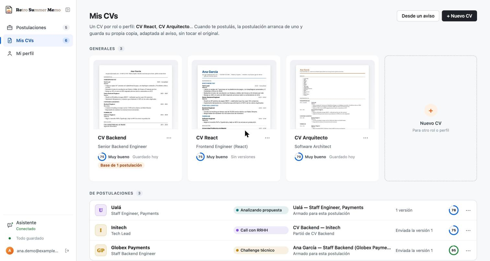
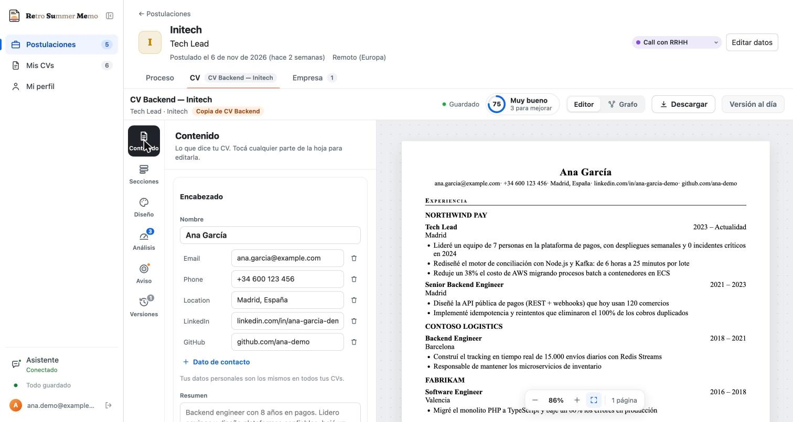
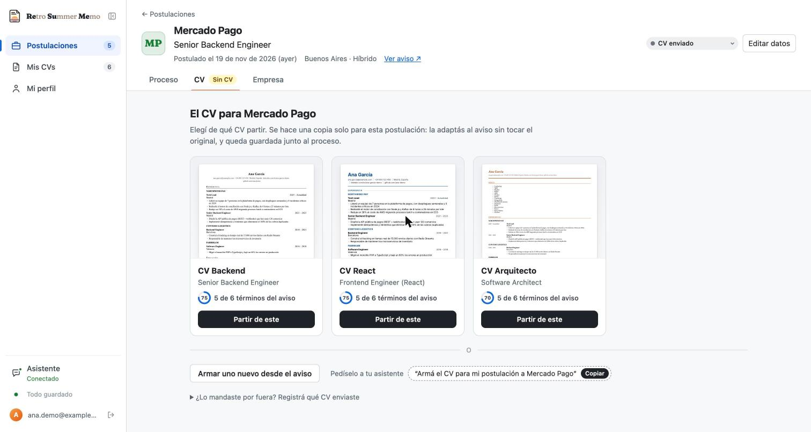
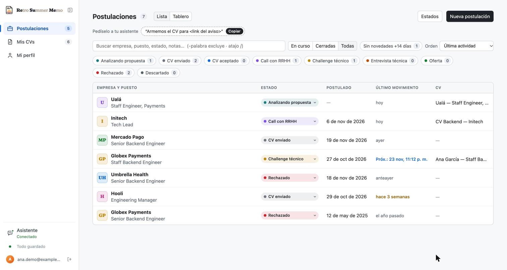
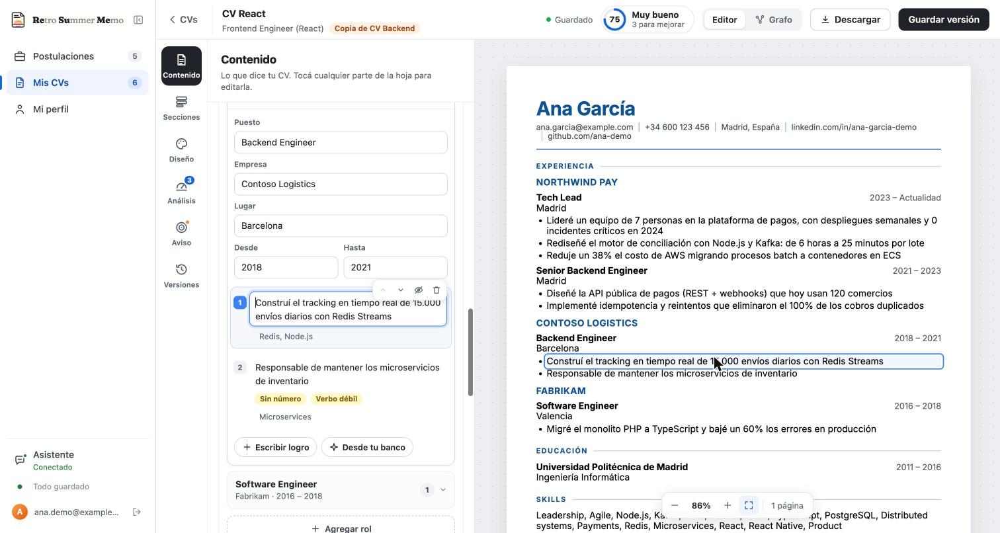
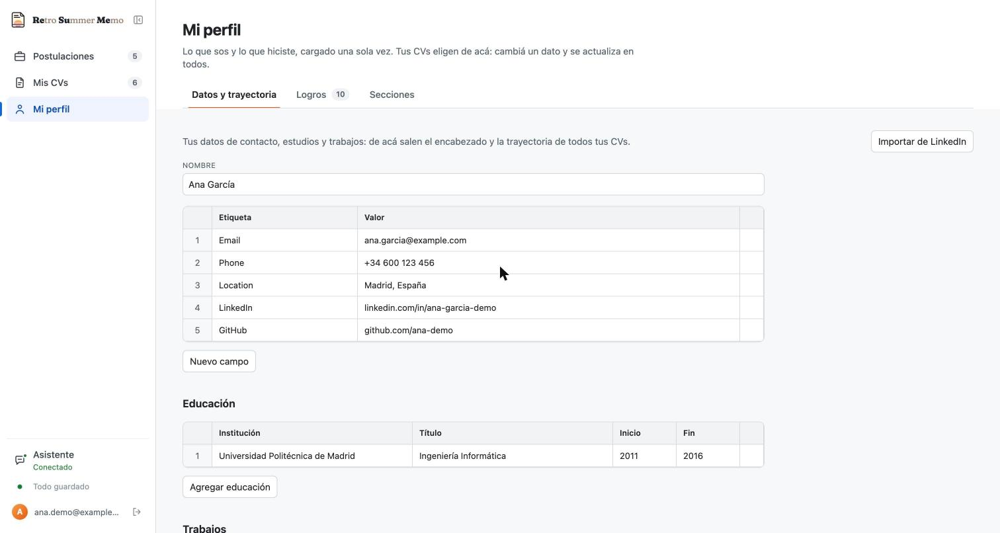
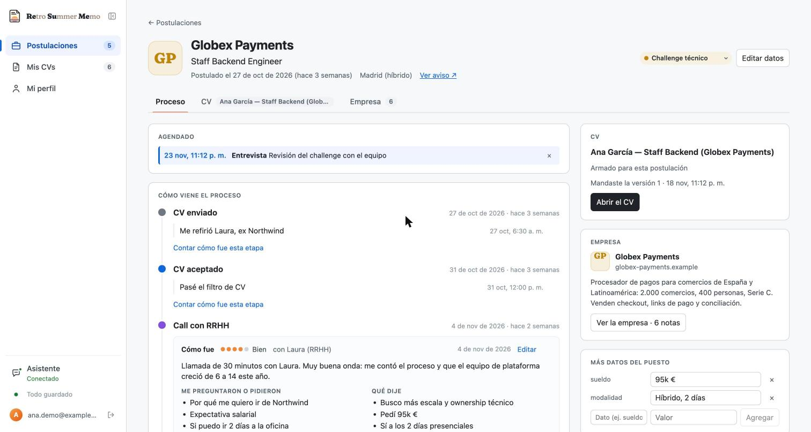

# CV builder + job applications tracker

Three sections: **Postulaciones**, **Mis CVs** and **Mi perfil**, each with its own URL.

- **Mis CVs**: general CVs, one per role or profile ("CV React", "CV Arquitecto"), made from the
  whole profile, from another CV or from scratch. Each is edited in a visual editor (the CV live on
  a canvas, with panels for its content, sections, design, an analysis with a score, the target
  posting and fixed versions).
- **Postulaciones**: every application you send, what step each process is in, and whether you
  already applied to that posting or role before. Each application is a page with three tabs: the
  process step by step (how each call or interview went: what they asked, what you said and did not
  say, what they liked), **its own CV** (a copy of one of your general CVs, tailored to that posting
  in the same editor, with the exact version you sent), and everything known about the company:
  logo, what it does, mission, vision, values, and dated notes on news, layoffs, hiring, other
  openings and how others' interviews went.
- **Mi perfil**: your data and career, your achievements (one CV line each) and the CV sections:
  what every CV is made from, entered once.

It is driven by your assistant (ChatGPT, Claude, Gemini…) through an MCP server: "Preparemos mi
Resume", a bare posting link, "Armemos el CV para <link>", "Mañana tengo call con RRHH de Acme",
"Recién salí de la call con RRHH, te cuento…", "Investigá Acme". The app is the engine and the
viewer, and shows the assistant's changes live.

| Mis CVs: a general CV per role, and the CV of each application | An application's CV, in the editor, in its own tab |
| --- | --- |
|  |  |

| Starting an application's CV from a general one | Applications |
| --- | --- |
|  |  |

| The CV editor: click any part of the page to edit it | Mi perfil |
| --- | --- |
|  |  |

| How it reads to a screening filter and a recruiter | Template, color and typography |
| --- | --- |
|  |  |

| An application: the process, its CV and the company | How each step went, and what is known about the company |
| --- | --- |
|  |  |

More in [docs/screenshots](docs/screenshots).

## Architecture

```
src/
  domain/     pure model and rules: CV graph, build, matching, applications, parsing
  app/        use cases on top of the ports (e.g. openDocument)
  ports/      interfaces the app depends on: DocumentStore, AuthGateway
  adapters/   implementations: local (localStorage), supabase (Postgres + Auth + Realtime)
  backend.ts  composition root: picks the adapters from the environment
  ui/         React: Root (sign-in, loading), App, components
supabase/     local stack config and SQL migrations (RLS: each user sees only their rows)
```

The UI and the use cases only talk to `ports/`. Swapping the backend means writing another
adapter that passes `ports/documentStore.contract.ts`.

## Run it

```bash
npm install
npm run db:start                      # local Supabase in Docker (first run downloads images)
cp .env.example .env.local            # then paste the publishable key from:
npx supabase status -o env            #   PUBLISHABLE_KEY=...
npm run dev                           # http://localhost:5173
```

Sign in with any email; locally the link arrives in Mailpit at http://127.0.0.1:54324.
On first sign-in, data saved in this browser by the older localStorage version is imported.

Without `VITE_SUPABASE_*` the app runs entirely in the browser, as before.

## Cloud project

`npm run dev` talks to the local stack (`.env.local`); `npm run build` / `npm run preview` use
`.env.production.local` (cloud URL + publishable key, gitignored). The secret key is never needed
by the app: Edge Functions (the MCP) receive it from Supabase itself.

```bash
npx supabase login                                   # once, opens the browser
npx supabase link --project-ref attrxmtjyjzfgopfrgnk
npx supabase db push --remote                        # applies supabase/migrations (without
                                                     # --remote, CLI 3.x targets the local stack)
```

Redirect URLs (Authentication → URL Configuration) must include every origin the app is served
from, or sign-in links bounce to the Site URL. Set: Site URL `https://retro-summer-memo.com`,
redirects `https://retro-summer-memo.com/**`, `https://retro-summer-memo.vercel.app/**` and
`http://localhost:4173` (preview).

## Deploy

The frontend is a static build on Vercel (Supabase does not host frontends) at
https://retro-summer-memo.com (`www` redirects there; the domain's DNS is at GoDaddy, pointing to
Vercel; https://retro-summer-memo.vercel.app keeps working). `VITE_SUPABASE_URL`,
`VITE_SUPABASE_PUBLISHABLE_KEY` and `VITE_MCP_URL` are set in the Vercel project (Production);
`.vercelignore` keeps local env files out of the upload.

**CI/CD** (`.github/workflows/ci.yml`): every pull request runs lint, unit tests and both builds,
and starts a real Supabase in the runner to apply every migration and run the integration and
MCP end-to-end tests. A merge to `main` then deploys, one deploy at a time and in this order:
database migrations (`supabase db push`), the `mcp` function, the app on Vercel; and checks that
the site answers and the MCP asks for sign-in. The app is built on Vercel (where its production
variables are; `vercel pull` does not hand their values out) without the domain, checked to carry
its Supabase settings, and only then promoted, so a broken build never goes live. It needs, in Settings → Secrets and variables →
Actions: the secrets `SUPABASE_ACCESS_TOKEN` and `VERCEL_TOKEN`, and the variables
`SUPABASE_PROJECT_REF`, `VERCEL_ORG_ID` and `VERCEL_PROJECT_ID` (from `.vercel/project.json`).
Migrations must be additive: the database is updated before the code that uses it.

By hand, if ever needed:

```bash
npx supabase db push --remote=attrxmtjyjzfgopfrgnk --yes
npm run mcp:deploy -- --remote=attrxmtjyjzfgopfrgnk --yes
vercel deploy --prod      # from the repo root (project already linked in .vercel/)
```

Do not `supabase config push` this repo's `config.toml` to the cloud: it holds local-dev values
(email confirmations and MFA off). Run `supabase config diff` first and push only what you mean to.

## MCP (Claude, ChatGPT, Gemini…)

The assistant is the main way to use Resume: "Actualizá mi info en Resume", "Armemos el CV para
<link>", "Me confirmaron de Acme, paso al challenge el 20/3". `supabase/functions/mcp` is a remote
MCP server at **`https://retro-summer-memo.com/mcp`**: `vercel.json` forwards it to the function's
`_site` sub-path, which advertises that URL as the OAuth resource. The function's own URL,
`https://attrxmtjyjzfgopfrgnk.supabase.co/functions/v1/mcp`, works too.

- The tools live in `src/mcp` and work on the whole document through the `DocumentStore` port, so
  they change data exactly like the app (same domain code, same incremental saves). The model the
  assistant sees: profile → sections → entries → experiences → CVs → applications ↔ companies
  (matched by name).
  - Starting point: `get_started`, which the assistant calls first whenever work comes up (even
    without the user naming Resume). It returns today's date, how complete the account is (setup
    gaps: contact details, roles without achievements, achievements without numbers…), the agenda
    (what is coming up, steps that happened without a debrief, postings waiting for a decision,
    quiet processes), the pipeline, and `start_with`: what to ask first. An empty account also gets
    `onboarding_guide` (old CVs and LinkedIn first, then an interview role by role).
  - Follow-ups: write tools answer with `follow_up`, what is missing or worth asking now (a role
    with no achievements, an achievement with no number, who a call is with, how an interview
    went), so every assistant keeps the same back-and-forth.
  - Content: `get_profile`, `update_profile`, `list_sections`, `save_section`, `delete_section`,
    `save_entry`, `delete_entry` (one CRUD for every section: experience = roles, education,
    projects, or any section the user adds), `list_experiences`, `save_experience` (linked to the
    entry where it happened), `delete_experiences`, `set_experience_levels`, `import_career`
    (a whole old CV, LinkedIn export or long story in one call; merges instead of duplicating).
  - CVs: `cv_guidelines` (how to build CVs that pass ATS/AI screening and land), `list_cvs`
    (general CVs, one per role, and the CV of each application), `build_cv` (a selection; the server
    lays out the graph, generates the version and returns an outline and a review: length, summary,
    results, wording, keywords backed by the bank; with `application_id` it builds or rebuilds that
    application's CV), `copy_cv` (a new general CV from another, or an application's CV from a
    general one), `update_cv` (also moves a CV into or out of an application), `build_cv_version`
    (with `pin_to_application_id`: the version sent), `delete_cv`.
  - Applications: `check_duplicates`, `create_application` (stage `considering`: a posting the user
    is weighing, in "Analizando propuesta", with how it fits their experience; or `applied`),
    `move_application` (leaving "Analizando propuesta" records the day they applied),
    `schedule_step` (a call, interview or deadline coming up, optionally moving the step), `add_note`,
    `save_debrief` (how a step went: rating, people, asked, said, unsaid, liked, concerns),
    `delete_event`, `update_application`, `delete_application`, `delete_status`,
    `search_applications`, `get_application`.
  - Companies: `get_company` (info, notes, and the user's applications to it with their debriefs),
    `save_company` (website, logo, about, mission, vision, values, extra), `save_company_note`
    (news, hiring, layoff, role, interview, culture, salary, funding… with date and source),
    `delete_company_note`, `delete_company`.
  - Anything else: `describe_model`, `get_document`, `update_document` (JSON Patch, `[id=…]` paths).
  - Prompts: `preparar-mi-resume`, `actualizar-mi-info`, `armar-cv`, `analizar-aviso`,
    `como-me-fue`, `investigar-empresa`, `preparar-entrevista`, `novedad`.
- Everything is open: every entity keeps extra data under `extra`, status, event and note kinds are
  free, events dated in the future are "coming up".
- Logos: the image URL saved for the company, else its website's icon (Google's favicon service,
  requested by the browser with no referrer), else its initials.
- Auth: Supabase Auth's OAuth 2.1 server with dynamic client registration. Clients are sent to
  `/oauth/consent` (`src/ui/Consent.tsx`); tools run as the signed-in user, so RLS applies. The app
  lists connected assistants and can disconnect them.
- `npm run mcp:build` bundles `src/mcp` with Vite into `supabase/functions/mcp/generated` (gitignored).

```bash
npm run mcp:serve                     # build + serve locally: http://127.0.0.1:54321/functions/v1/mcp
npm test                              # includes the tools, over an in-memory store
npm run test:mcp                      # end to end against the served function
npm run mcp:deploy -- --remote=attrxmtjyjzfgopfrgnk
```

## Checks

```bash
npm run build              # type-check + production build
npm run lint
npm test                   # unit + contract tests (no network)
npm run test:integration   # against the local Supabase: contract, RLS, live changes
npm run db:reset           # wipe the local database and re-apply migrations
```
